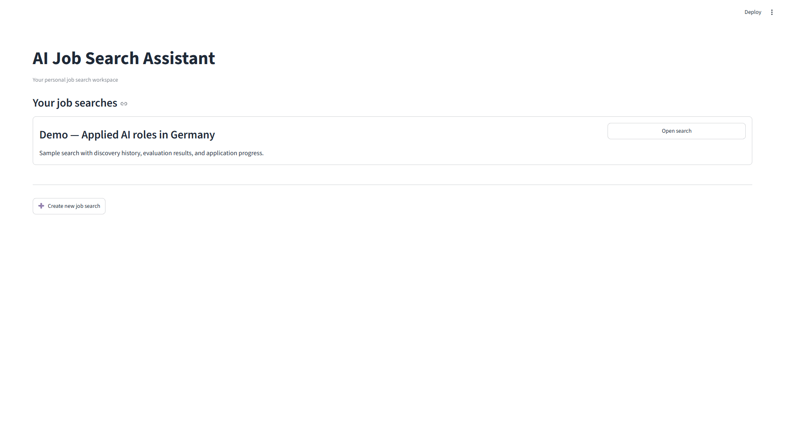

# AI Powered Job Search

AI Powered Job Search is a local Streamlit workspace for finding jobs, checking them against a candidate profile, and tracking application progress. It combines [Freehire](https://freehire.me/) job discovery, configurable local filters, Ollama based job evaluation, and a SQLite database.



The walkthrough shows the saved search overview, two dashboard views including the Sankey chart, then Run Search, Job Results, and Search Configuration. All included companies and job listings are fictional demo records.

## Requirements

- Python 3.12
- [uv](https://docs.astral.sh/uv/) and [Task](https://taskfile.dev) for installing the locked dependencies
- Ollama and a model that matches the active profile for job evaluation (the default profile uses `qwen3.5:9b`)
- Internet access when running Freehire discovery

You can browse the app and its saved demo results without Ollama or a Freehire connection.

## Set up

Clone the repository and open a terminal in the project directory. Install the project dependencies:

```bash
task create-venv
```

The project uses SQLite. It creates a new database only through the database setup scripts; the app expects the configured database file to exist before launch.
Code to setup a fresh database:

```bash
python scripts/create_database.py data/job_search.db
```

If the file already exists, the setup script stops rather than overwriting it. Use a different path or back up and remove the file yourself before creating a replacement.

After setting up the fresh database start the application by running:
```bash
streamlit run app.py
```

## First search setup

1. On **Job Searches**, create a search with a name and optional description.
2. Open **Search Configuration** and enter the candidate profile, discovery terms, location and work preferences, and evaluation settings.
3. Start Ollama and download the model selected in the active profile before evaluating jobs. For example, with the default model:

   ```bash
   ollama pull qwen3.5:9b
   ```

4. Go to **Run Search** and run Freehire discovery. The app saves listings and applies local filters before evaluation.
5. Evaluate the eligible jobs. Evaluation sends job descriptions and candidate-profile information to the local Ollama service running at `http://localhost:11434`.
6. Review matches and update application statuses on **Job Results**. Use the **Dashboard** to see discovery, evaluation, and application progression.

## Pages and navigation

Choose the active search from the sidebar. Its navigation links lead to:

- **Dashboard** — counts for discovered, filtered, and evaluated jobs, application totals, a progression chart, and recent search runs.
- **Run Search** — Freehire discovery, manual job entry, and queued LLM evaluation.
- **Job Results** — evaluated roles grouped for review, active applications, AI filtered results, and rejected or withdrawn applications. Update a status from the job card and see its history.
- **Search Configuration** — edit the active candidate profile, search parameters, filters, and evaluation model and scoring weights. Saved profiles are versioned.
- **Job Searches** — create and inspect saved searches.
- **All job searches** — return to the home page and open a saved search.
